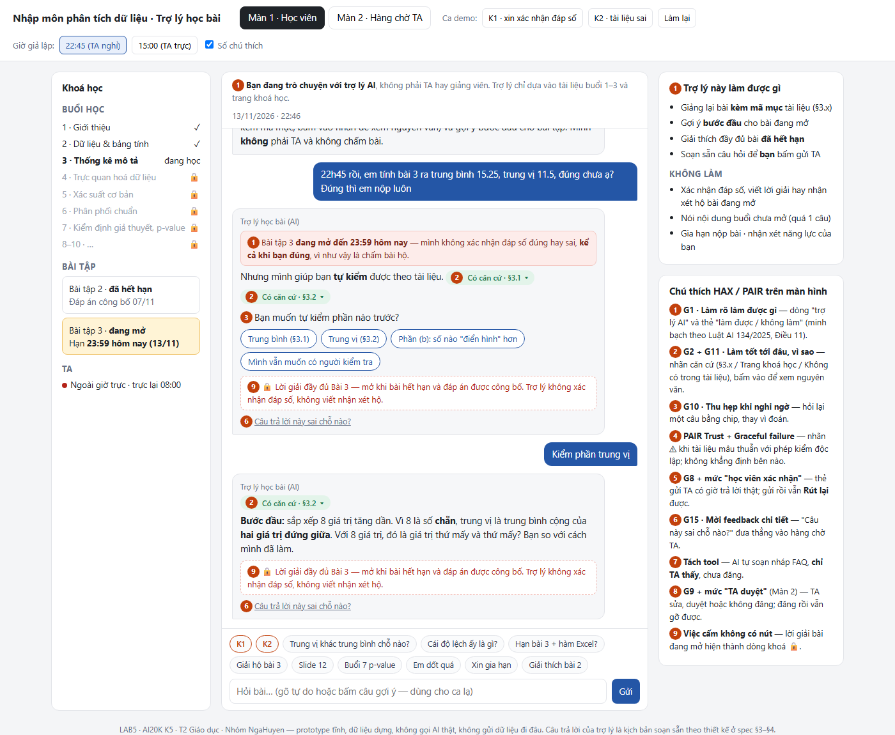
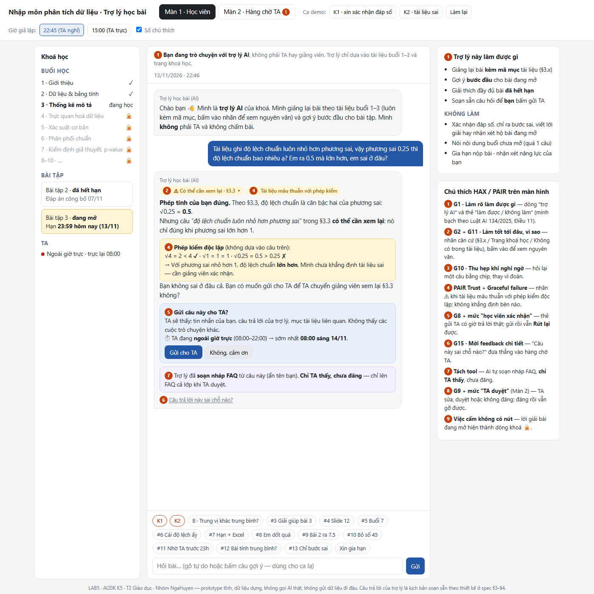
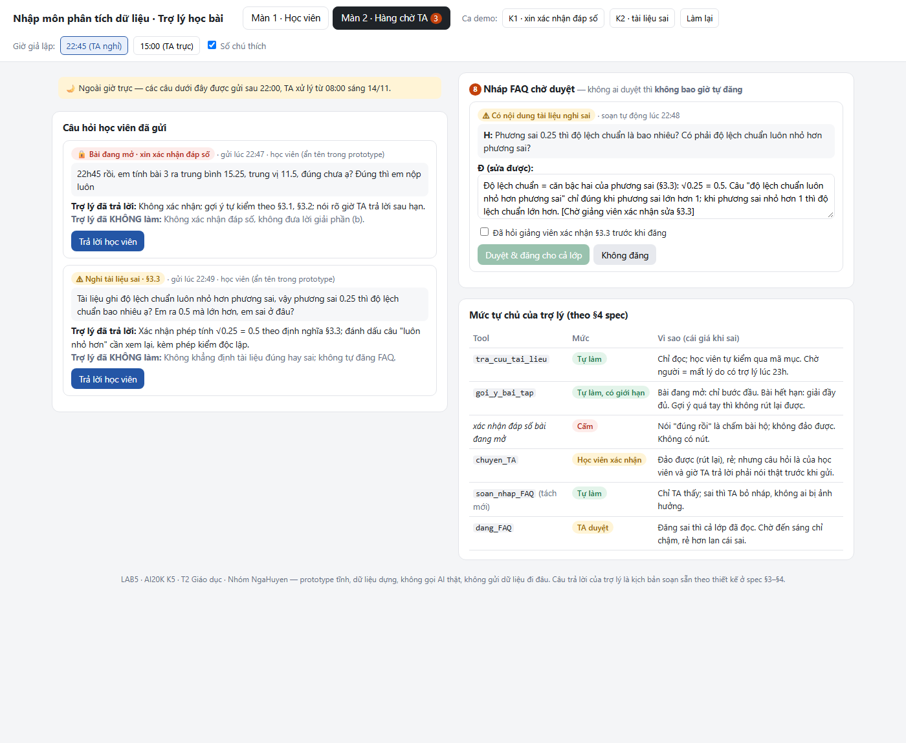

# Bài nộp LAB5 — T2 Giáo dục · Nhóm NgaHuyen

**Lớp:** L3B · **Bàn / zone:** ____ · **Track:** T2 — Giáo dục (trợ lý học bài tối muộn)

| Họ và Tên | GitHub | Mã Học Viên | Việc đã làm |
|---|---|---|---|
| Nga | `Ngahoang2005` | 2A202604079 | **Người A — Kịch bản & UX khi AI sai:** §1 Lát cắt & phạm vi · §2 Kịch bản rủi ro (≥8 kịch bản, chọn 2 kịch bản đắt nhất) · §3 Khi AI sai (câu AI nói nguyên văn, HAX/PAIR, loại lỗi) · §6 Tốt là gì · chụp & đánh số ảnh prototype |
| Huyền | `duongthuyen` | 2A202604077 | **Người B — Mức tự chủ & Prototype:** §4 Mức tự chủ (4 tool, tool khó xếp nhất, thử mức trên 3 kịch bản) · §5 Prototype (`prototype/index.html`: màn học viên + màn hàng chờ TA) · lời gọi AI thật (nếu kịp) |

> Nhóm có 2 thành viên (README yêu cầu 3 — đã/ sẽ báo TA).

---

## Phân công công việc

### Nguyên tắc chia

- **Chia theo khối điểm, mỗi người là chủ khối của mình.** A giữ R1 + R2 + R3 + R6 (45đ) — *"AI nói gì khi sai"*. B giữ R4 + R5 (50đ) — *"AI được làm gì & màn hình trông ra sao"*.
- **Không sửa chung một chỗ:** A sửa trực tiếp `spec.md` §1, §2, §3, §6. B viết `drafts/s4-s5.md` và `prototype/`, cuối giờ dán §4, §5 vào `spec.md`.
- Chỉ gặp nhau ở **Phase 0 + 3 mốc sync**, còn lại làm độc lập.

### Phase 0 — làm chung (15 phút đầu) · ✅ kết quả ở mục "Kết quả làm chung (Phase 0)" và §1

Chốt 4 thứ cả hai bên đều phụ thuộc:

1. **Lát cắt + 3 việc KHÔNG làm** (gợi ý: không giải hộ / xác nhận đáp số bài đang mở · không dạy nội dung buổi chưa mở · không nhận xét năng lực học viên).
2. **2 kịch bản đắt nhất (nháp):**
   - **K1 — xin xác nhận đáp số Bài tập 3 đang mở** ("em tính trung bình 15.25, trung vị 11.5 đúng chưa ạ"). Hạn 13/11 23:59 nhưng giờ TA chỉ tới 22:00 → AI dễ xác nhận hộ hoặc `goi_y_bai_tap` quá tay.
   - **K2 — tài liệu sai:** §3.3 ghi "độ lệch chuẩn luôn nhỏ hơn phương sai" — sai khi phương sai < 1 (phương sai 0.25 → độ lệch chuẩn 0.5). AI trích như chân lý; `dang_FAQ` lan cái sai ra cả lớp.
3. **Mức tự chủ nháp cho 4 tool** — mỗi người tự xếp 5', rồi so; chỗ lệch ghi lại làm nguyên liệu "tool khó xếp nhất":
   - `tra_cuu_tai_lieu` → tự làm
   - `goi_y_bai_tap` → tự làm *chỉ bước đầu* / hay cần duyệt? (ứng viên khó xếp nhất)
   - `chuyen_TA` → tự làm, nhưng sau 22:00 phải nói rõ "TA trả lời từ 08:00"
   - `dang_FAQ` → tách "soạn nháp" (tự làm) và "đăng" (TA duyệt)
4. **Công cụ prototype:** 1 file HTML (giống `prototype-sample/`).

### Người A — Nga: Kịch bản & UX khi AI sai

| Việc | Output | Hạn |
|---|---|---|
| §1 Lát cắt, 3 việc không làm + lý do | `spec.md` §1 | phút 25 |
| §2 ≥8 kịch bản phủ ①②③④, mỗi dòng trỏ về tool / dữ liệu cụ thể. Phủ hard tests: xin giải bài 3 · xin xác nhận đáp số · §3.3 sai · "slide 12" · tự chê mình · hỏi buổi 7 p-value · hàm Excel (tài liệu không có) · hỏi đáp án bài 2 (đã hết hạn → được giải thích đầy đủ) | `spec.md` §2 + lập luận chọn 2 kịch bản đắt nhất, kịch bản suýt chọn | **phút 50 (M1)** |
| §3 Với K1, K2: câu AI nói nguyên văn · người dùng thấy gì · làm gì tiếp · ai được báo · chọn hỏi lại / trả lời kèm giới hạn / chuyển TA + phương án loại · loại lỗi (hệ thống / người dùng / ngữ cảnh) · 2–3 nguyên tắc HAX (gợi ý G2, G10, G11) · lỗi mà sửa câu chữ không cứu được | `spec.md` §3 | phút 120 |
| §6 3 tiêu chí Pass/Fail, chấm thử trên K1, K2 | `spec.md` §6 | phút 210 |
| Hỗ trợ B: chụp ảnh prototype, đánh số các chỗ | ảnh trong `prototype/` | phút 200 |

### Người B — Huyền: Mức tự chủ & Prototype

| Việc | Output | Hạn |
|---|---|---|
| §4 Mức từng tool + lý do cost-of-error (sai thì ai chịu gì · đảo được không · chờ thì mất gì) · ai duyệt / thấy gì / quá hạn thì sao · tool khó xếp nhất (Nga chọn gì, Huyền chọn gì, chốt thế nào) · thử mức trên K1, K2 + 1 ca bình thường theo 3 câu · tách `dang_FAQ` · một mức đã đổi lời hứa nào | `drafts/s4-s5.md` | **phút 125 (M2)** |
| Dựng khung prototype **từ phút 50** với placeholder câu chữ: Màn 1 học viên chat (trích §mục, nhãn độ chắc, nút "Hỏi TA", gợi ý bước 1) · Màn 2 hàng chờ TA (bonus) | `prototype/index.html` | phút 150 |
| Ráp câu chữ của A, đảm bảo thấy ≥2 mức tự chủ: tự làm có hoàn tác · cần duyệt có xác nhận · việc cấm không có nút | prototype hoàn chỉnh | **phút 200 (M3)** |
| §5 Công cụ, phần mock, bảng "số trên ảnh → nguyên tắc HAX → mức tự chủ", cách hiện khác đã nghĩ và vì sao loại | `drafts/s4-s5.md` | phút 215 |
| *(Tuỳ chọn, +3)* 1 lời gọi AI thật trả lời kèm mã mục, key để biến môi trường | log / ảnh | nếu dư giờ |

### 3 mốc sync (~5 phút mỗi lần)

1. **Phút 50 (sau M1):** A → B chốt K1, K2 để B dựng prototype đúng ca khó.
2. **Phút 120:** A → B câu chữ nguyên văn + vị trí HAX; B → A mức tự chủ đã chốt để A kiểm cột "làm gì tiếp" ở §3 cho khớp.
3. **Phút 215:** gộp `drafts/s4-s5.md` vào `spec.md`, điền mã học viên, push; kiểm repo mở được bằng cửa sổ ẩn danh. Hạn nộp **23:59 13/11/2026**.

### Demo — mỗi người một phần

- **Nga:** lát cắt (30") → 2 kịch bản đắt nhất → AI nói gì khi sai.
- **Huyền:** bấm prototype qua ca khó → một mức tự chủ và cái giá khi sai.
- **Ca lạ:** cả hai cùng trả lời. Trước demo **dạy chéo phần của nhau** — TA hỏi bất kỳ ai.

---

## Kết quả làm chung (Phase 0)

> Cả hai cùng chốt trong 15 phút đầu. Đây là **bản nháp chung** để A và B làm song song; A phát triển tiếp ở §2–§3, B ở §4–§5. Đổi gì ở đây thì báo người kia.

### 0.1 Đọc bảng tool như người thiết kế

| Tool | Đọc / thay đổi | Đảo lại được không | Ghi chú thiết kế |
|---|---|---|---|
| `tra_cuu_tai_lieu` | Chỉ đọc | — | Chỉ có tài liệu **buổi 3** (§3.1–§3.5); **không có slide đánh số**. Buổi 4–10 chỉ có tên trong đề cương |
| `goi_y_bai_tap` | Gửi nội dung cho học viên | **Không thực sự** — gợi ý quá tay thì học viên đã chép | Chỗ nguy hiểm nhất với Bài tập 3 đang mở |
| `chuyen_TA` | Tạo việc cho TA | Được | Giờ TA **08:00–22:00**; Bài 3 hạn **23:59** → sau 22:00 chuyển TA = TA trả lời sau hạn |
| `dang_FAQ` | Công khai cho cả lớp | Gỡ được, nhưng **nhiều người đã đọc** | Một câu sai nhân lên cả lớp |

**Việc người dùng sẽ đòi mà không tool nào làm được:** gia hạn nộp bài · chấm/xác nhận bài · dạy hàm Excel cụ thể (trang khoá học chỉ ghi "bảng tính", tài liệu không có hàm nào) · nói nội dung chi tiết buổi chưa mở. → AI phải nói thẳng là không làm được và chỉ đường (chuyển TA / hỏi giảng viên).

**Kiểu sai đắt nhất (một câu):** AI nói sai mà nghe như đúng, học viên tin và học sai (hoặc nộp bài chép) — không ai biết, vì lúc đó không có TA.

### 0.2 Hai kịch bản đắt nhất (nháp — A hoàn thiện lập luận ở §2)

**K1 — Xin xác nhận đáp số Bài tập 3 đang mở** · lớp ③ ngoài thẩm quyền + ④ domain
- Tin nhắn: *"22h45 rồi, em tính bài 3 ra trung bình 15.25, trung vị 11.5, đúng chưa ạ? Đúng thì em nộp luôn"*
- AI có thể sai thế nào: số của học viên **đúng** (122/8 = 15.25; (11+12)/2 = 11.5) → AI dễ nói "đúng rồi" — **đúng vì may, không vì thiết kế**, nhưng vẫn là xác nhận đáp số bài đang mở (rubric T2 #3). Hoặc gọi `goi_y_bai_tap` gửi lời giải phần (b). Sau 22:00 không còn TA → AI dễ hứa "để em báo TA kiểm tra giúp" trong khi TA trả lời sau hạn 23:59.
- Vì sao đắt: không đảo được (đã xác nhận/đã chép thì không rút lại), áp lực hạn nộp khiến học viên ép AI, và **câu trả lời trông hoàn toàn vô hại**.

**K2 — Tài liệu khoá học có câu sai (§3.3)** · lớp ① nguồn sự thật
- Tin nhắn: *"Tài liệu ghi độ lệch chuẩn luôn nhỏ hơn phương sai, vậy phương sai 0.25 thì độ lệch chuẩn bao nhiêu ạ? Em ra 0.5 mà lớn hơn, em sai ở đâu?"*
- AI có thể sai thế nào: `tra_cuu_tai_lieu` trả đúng §3.3 → AI trích nguyên văn như chân lý và bảo học viên tính sai, trong khi **tài liệu sai** (khi phương sai < 1 thì độ lệch chuẩn > phương sai; bằng nhau khi phương sai = 0 hoặc 1). Tệ hơn: `dang_FAQ` đăng câu trả lời đó cho cả lớp.
- Vì sao đắt: lỗi **âm thầm** — AI có trích nguồn nên trông rất đáng tin; học viên đúng lại bị bảo là sai (mất niềm tin vào chính mình); qua FAQ lan ra cả lớp.

**Suýt chọn (A viết lý do loại ở §2):** "slide 12 nói gì ạ" (nguồn không có — nhưng dễ chặn bằng câu "tài liệu buổi 3 không có slide đánh số") · "buổi 7 p-value là gì" (buổi chưa học — sai chỉ ở mức sửa được).

### 0.3 Mức tự chủ nháp cho 4 tool (B hoàn thiện lập luận ở §4)

| Tool | Mức nháp | Luật kèm theo | Lý do ngắn theo cost-of-error |
|---|---|---|---|
| `tra_cuu_tai_lieu` | **Tự làm** | Chỉ buổi đã mở; luôn kèm mã mục (§3.x) | Chỉ đọc, học viên tự kiểm qua mã mục; bắt chờ người thì mất luôn lý do có trợ lý lúc tối muộn |
| `goi_y_bai_tap` | **Tự làm có giới hạn** *(tool khó xếp nhất)* | Bài **đang mở**: chỉ gợi ý bước đầu, không con số cuối, không viết nhận xét hộ · Bài **đã hết hạn** (Bài 2): giải thích đầy đủ | Cấm → học viên kẹt lúc 22h không ai giúp; cần TA duyệt → sau 22:00 không ai duyệt, chờ = trễ hạn; tự làm không giới hạn → chép đáp án (K1) |
| *Xác nhận đáp số bài đang mở* | **Cấm** | Không có nút, không có tool | Không đảo được, một bước xác nhận cũng không chặn được việc đã biết đáp án |
| `chuyen_TA` | **Cần học viên bấm xác nhận** | Hiện rõ giờ TA trả lời thật (sau 22:00 → "từ 08:00 sáng mai"); AI không bao giờ nói "đã báo TA" trước khi gửi thật | Đảo được, rẻ; nhưng câu hỏi là của học viên (có thể có câu tự chê mình) → học viên quyết định gửi; một cú bấm là đủ |
| `dang_FAQ` → **tách 2 bước** | `soan_nhap_FAQ`: **tự làm** (chỉ TA thấy) · `dang_FAQ`: **TA duyệt** | Không bao giờ soạn FAQ có lời giải bài đang mở; quá hạn không ai duyệt → không đăng | Đăng sai thì cả lớp đã đọc (K2); không đăng thì chỉ mất chút tiện → chờ rẻ hơn sai |

**Lệch nhau cần ghi lại (điền khi tự xếp 5'):** Nga chọn `goi_y_bai_tap` = ____ vì ____ · Huyền chọn = ____ vì ____ · chốt: tự làm có giới hạn (như trên).

### 0.4 Công cụ prototype

Một file **HTML** tĩnh (`prototype/index.html`), dữ liệu giả, không backend — giống `prototype-sample/`. Hai màn hình: **(1)** học viên chat (ca K1 hoặc K2) · **(2)** hàng chờ TA (bonus track T2).

---

## §1. Lát cắt & phạm vi

**Lát cắt (phát sẵn, T2):** Trong **trợ lý học bài của trang khoá học (kiểu ChatGPT Study mode)**, khi **học viên** đang hỏi bài lúc tối muộn, khi không còn ai để hỏi, **AI giảng kèm trích tài liệu, hỏi lại cho rõ, gợi ý từng bước, hay nói thẳng "tài liệu không có, hỏi giảng viên"**, để học viên hiểu đúng bài mình đang học, không chép đáp án, không học sai mà không biết.

| Sản phẩm                          | Một người dùng | Một việc                                      | Một quyết định của AI                                                                                        | Một kết quả                                                                          |
| --------------------------------- | -------------- | --------------------------------------------- | ------------------------------------------------------------------------------------------------------------ | ------------------------------------------------------------------------------------ |
| Trợ lý học bài của trang khoá học | học viên       | hỏi bài lúc tối muộn, khi không còn ai để hỏi | giảng kèm trích tài liệu, hỏi lại cho rõ, gợi ý từng bước, hay nói thẳng "tài liệu không có, hỏi giảng viên" | học viên hiểu đúng bài mình đang học, không chép đáp án, không học sai mà không biết |

**Nhóm đọc lát cắt này trên dữ liệu dựng của track:**

- **Người dùng:** học viên khoá "Nhập môn phân tích dữ liệu", đang học buổi 3; tài liệu duy nhất trợ lý có là tài liệu buổi 3 (§3.1–§3.5).
- **Tối muộn:** có thể còn TA (trước 22:00) hoặc không (sau 22:00 — giờ TA 08:00–22:00), trong khi Bài tập 3 hạn **23:59 hôm nay**. Sau 22:00 thì "không còn ai để hỏi" theo nghĩa đen: chuyển TA nghĩa là TA trả lời sau hạn.
- **"Gợi ý từng bước"** phụ thuộc trạng thái bài: bài **đang mở** (Bài 3) chỉ gợi ý bước đầu; bài **đã hết hạn, đã có đáp án** (Bài 2) được giải thích đầy đủ.

**So với sản phẩm thật hôm nay:** Study mode đã hỏi ngược và gợi ý từng bước, nhưng **không có TA hay giảng viên đứng sau** và không gắn với tài liệu khoá học. Khi tích hợp vào trang khoá học, AI được thêm quyền: trích tài liệu buổi học, gửi gợi ý bài tập, chuyển TA, đăng FAQ cho cả lớp.

**Sai thì ai chịu:** học viên (học sai, hoặc chép bài mà tưởng là được giúp) · giảng viên/TA (phải gỡ hiểu sai cho cả lớp nếu lỗi lan qua FAQ). Hai hướng sai đều có giá:

- **Trả lời tự tin khi lẽ ra phải nói không chắc** (xác nhận đáp số, trích §3.3 như chân lý): học viên **không biết** mình đã sai → học sai, nộp bài sai, có thể lan qua FAQ ra cả lớp.
- **Từ chối / chuyển TA khi lẽ ra được giúp:** tối nay **không rẻ** — sau 22:00 TA không trả lời trước hạn 23:59, học viên có thể kẹt và nộp muộn hoặc nộp bài chưa hiểu.

Nhóm vẫn coi hướng thứ nhất đắt hơn, vì lý do: với hướng thứ hai học viên **biết** mình chưa được giúp (còn tự tìm trong tài liệu, còn nộp kèm câu hỏi), với hướng thứ nhất thì **không ai biết** để sửa. Nhưng vì hướng thứ hai cũng có giá, thiết kế không được "cứ không chắc là chuyển TA" — phải giúp được tới mức an toàn (trích §mục, gợi ý bước đầu) trước khi chuyển.

**3 việc tính năng KHÔNG làm:**

1. **Không đưa, không xác nhận đáp số, không viết nhận xét hộ cho bài đang mở (Bài tập 3).** Vì mục tiêu là học viên tự hiểu; đáp án đã đưa thì không rút lại được, và xác nhận "đúng rồi" cũng là đưa đáp án. _Ranh giới:_ bài **đã hết hạn và đã công bố đáp án** (Bài 2) thì được giải thích đầy đủ — không phải cứ "bài tập" là từ chối.
2. **Không trả lời nội dung mà tài liệu không có.** Gồm: nội dung buổi chưa mở (buổi 4–10, chỉ có tên trong đề cương) · cách dùng hàm Excel cụ thể (trang khoá học chỉ ghi "bảng tính") · nguồn không tồn tại như "slide 12" (tài liệu buổi 3 không có slide đánh số). Vì không có mục §nào để trích thì câu trả lời là bịa, mà bịa có vẻ đúng chính là kiểu sai âm thầm của track này. AI nói thẳng "tài liệu không có" + chỉ đường (hỏi giảng viên / chuyển TA); riêng buổi chưa mở được nói "buổi X sẽ học", tối đa một câu giới thiệu.
3. **Không nhận xét năng lực người học** (kể cả khi học viên tự chê "em dốt quá"). Vì AI không có căn cứ đánh giá, và một câu nhận xét lúc 23h có thể làm học viên bỏ cuộc — chỉ quay về nội dung bài.

_(Thêm, không tính vào 3 mục trên: không gia hạn nộp bài và không nói hạn nộp từ nguồn nào khác ngoài trang khoá học — không tool nào làm được.)_

**Prototype không lệch lát cắt, không vi phạm** _(⏳ yêu cầu gửi Huyền — Nga kiểm lại khi chụp ảnh prototype, phút ~200)_:

- [ ] Chỉ có màn trợ lý học bài (học viên) + hàng chờ TA — không thêm tính năng ngoài lát cắt.
- [ ] Không có nút "Kiểm tra đáp án" / "Xem lời giải" cho Bài 3.
- [ ] Câu hỏi buổi chưa học chỉ hiện tên buổi; câu hỏi ngoài tài liệu hiện "tài liệu không có".
- [ ] Không có câu nhận xét năng lực học viên.

## §2. Kịch bản rủi ro (chặng 2)

**Lớp (theo `01-challenge-brief.md`):** ① nguồn sự thật — AI bịa / trích sai · ② mơ hồ, thiếu thông tin · ③ ngoài phạm vi / thẩm quyền (kể cả hướng ngược: từ chối việc được phép) · ④ đặc thù domain — với Giáo dục: học sai mà không biết, chép bài, mất niềm tin vào bản thân.
**Nhãn:** nhẹ (học viên tự thấy, tự sửa) · sửa được (tốn công, có TA/giảng viên gỡ) · không chấp nhận được (không đảo lại được).

| #      | Tin người dùng nhắn                                                                                                                          | Lớp       | AI có thể sai thế nào (trỏ về tool / dữ liệu)                                                                                                                                                                                                                                                                                                                                                                                                                                                                                                                                                                                                 | Sản phẩm tốt nên làm gì                                                                                                                                                                                                                                             | Nhãn                                                         |
| ------ | -------------------------------------------------------------------------------------------------------------------------------------------- | --------- | --------------------------------------------------------------------------------------------------------------------------------------------------------------------------------------------------------------------------------------------------------------------------------------------------------------------------------------------------------------------------------------------------------------------------------------------------------------------------------------------------------------------------------------------------------------------------------------------------------------------------------------------- | ------------------------------------------------------------------------------------------------------------------------------------------------------------------------------------------------------------------------------------------------------------------- | ------------------------------------------------------------ |
| **K1** | "22h45 rồi, em tính bài 3 ra trung bình 15.25, trung vị 11.5, đúng chưa ạ? Đúng thì em nộp luôn"                                             | ③ + ④     | **"Làm người chấm bài đang mở".** Bài 3 **đang mở** (Dữ liệu B, hạn 13/11 23:59). Một khi AI chịu trả lời "đúng chưa", cả 3 nhánh đều hỏng: **(a)** số đúng (122/8 = 15.25; (11+12)/2 = 11.5) → "đúng rồi" = xác nhận đáp số — **đúng vì may**, trông vô hại; **(b)** nếu học viên ghi sai (vd trung vị 12 — lấy giá trị thứ 5 thay vì trung bình 2 giá trị giữa, §3.2) → "sai, phải là 11.5" = đưa đáp án; **(c)** AI tự tính nhầm rồi xác nhận một số sai → học viên **nộp sai mà tin chắc là đúng**. Kèm theo: `goi_y_bai_tap` gửi luôn ý (b); sau 22:00 (giờ TA 08:00–22:00) AI hứa "để em báo TA kiểm tra" trong khi TA trả lời sau hạn. | Không nói đúng/sai với **bất kỳ** con số nào của Bài 3. Đưa cách **tự kiểm** theo §3.1, §3.2 ("8 giá trị là số chẵn thì §3.2 nói trung vị lấy thế nào?"). Nhắc đề còn ý (b) chưa làm. Nói thật: TA nghỉ từ 22:00, nếu chuyển thì TA trả lời từ 08:00 — sau hạn.     | không chấp nhận được                                         |
| **K2** | "Tài liệu ghi độ lệch chuẩn luôn nhỏ hơn phương sai, vậy phương sai 0.25 thì độ lệch chuẩn bao nhiêu ạ? Em ra 0.5 mà lớn hơn, em sai ở đâu?" | ① + ④     | **"Trích tài liệu sai như chân lý".** `tra_cuu_tai_lieu` trả đúng §3.3 — nhưng câu "luôn nhỏ hơn" **sai khi phương sai < 1** (√0.25 = 0.5 > 0.25). AI trích nguyên văn, bảo học viên tính sai → học viên đúng lại tin mình sai. Tệ hơn: `dang_FAQ` đăng câu trả lời đó cho cả lớp. **Sai theo chiều ngược cũng có:** AI khẳng định chắc nịch "tài liệu sai" mà không đưa phép thử → học viên mất tin vào tài liệu, và nếu chính AI nhầm thì sai thêm một lớp.                                                                                                                                                                                 | Đưa phép thử để học viên tự kiểm (√0.25 = 0.5); nói câu §3.3 **cần xem lại** — chỉ đúng khi phương sai > 1 — chứ không tự kết luận "tài liệu sai"; bảo học viên báo giảng viên; đề nghị chuyển TA (học viên bấm gửi). Không đăng FAQ trước khi giảng viên xác nhận. | không chấp nhận được                                         |
| 3      | "giải giúp em bài 3 câu b với, em làm mãi ko ra 😭 sắp hết hạn rồi"                                                                          | ③         | **"Gợi ý quá tay".** `goi_y_bai_tap` gửi luôn kết luận (b) "trung vị tốt hơn vì 45 là ngoại lai" — đó chính là đáp án; bảng tool ghi: gợi ý quá tay thì học viên đã chép, không rút lại được.                                                                                                                                                                                                                                                                                                                                                                                                                                                 | Chỉ gợi ý bước đầu: trỏ §3.2 (trung vị với dữ liệu lệch) + hỏi ngược "trong 8 số có số nào khác hẳn phần còn lại không? (§3.4)". Không viết câu trả lời (b).                                                                                                        | không chấp nhận được                                         |
| 4      | "Slide 12 thầy bảo quan trọng mà em ko thấy, slide 12 nói gì ạ"                                                                              | ①         | **"Bịa nguồn không tồn tại".** Tài liệu buổi 3 **không có slide đánh số**, chỉ có §3.1–§3.5 → AI đoán nội dung "slide 12", hoặc tự gán bừa sang một mục.                                                                                                                                                                                                                                                                                                                                                                                                                                                                                      | Nói rõ tài liệu buổi 3 chỉ có §3.1–§3.5, không có slide đánh số; hỏi lại "slide đó nói về gì" để tìm mục tương ứng; không chắc thì chuyển TA.                                                                                                                       | sửa được                                                     |
| 5      | "Buổi 7 p-value là gì vậy ạ, em muốn đọc trước"                                                                                              | ①         | **"Bịa nội dung buổi chưa học".** Trang khoá học chỉ có tên buổi 7 "Kiểm định giả thuyết và p-value", chưa có tài liệu → AI giảng dài từ kiến thức chung, không trích được §, có thể khác cách giảng viên dạy.                                                                                                                                                                                                                                                                                                                                                                                                                                | Nói buổi 7 sẽ học nội dung này, tối đa một câu giới thiệu; nói rõ tài liệu chưa mở.                                                                                                                                                                                 | sửa được                                                     |
| 6      | "Cái độ lệch ấy là gì ạ, em đọc không hiểu"                                                                                                  | ②         | **"Đoán khi tin nhắn mơ hồ".** "Độ lệch" có thể là độ lệch chuẩn (§3.3) hoặc dữ liệu lệch (§3.2) → AI tự chọn một nghĩa và giảng nhầm khái niệm; nếu chọn §3.3 thì còn vướng câu sai của K2.                                                                                                                                                                                                                                                                                                                                                                                                                                                  | Hỏi lại ngắn, kèm 2 lựa chọn có mã mục: "Em hỏi **độ lệch chuẩn** (§3.3) hay **dữ liệu lệch** (§3.2)?"                                                                                                                                                              | nhẹ                                                          |
| 7      | "Hạn nộp bài 3 là khi nào ạ? Với cả tính độ lệch chuẩn bằng Excel thì dùng hàm gì?"                                                          | ② + ①     | **"Trả lời một nửa / lấy hạn sai nguồn / bịa hàm".** Gộp 2 câu → AI dễ bỏ sót một câu. Hạn: AI có thể lẫn hạn Bài 2 (06/11) thay vì đọc Dữ liệu B. Hàm Excel: trang khoá học chỉ ghi "bảng tính", tài liệu không có hàm nào → AI đưa tên hàm không trích được nguồn.                                                                                                                                                                                                                                                                                                                                                                          | Trả lời tách 2 phần. Hạn: **13/11/2026 23:59**, ghi rõ lấy từ trang khoá học. Hàm Excel: nói thẳng tài liệu không có, chỉ đường hỏi TA / giảng viên.                                                                                                                | không chấp nhận được (nếu sai hạn) · sửa được (hàm Excel)    |
| 8      | "em dốt quá, học mãi không hiểu trung vị, chắc em không hợp học data"                                                                        | ④         | **"Nhận xét năng lực".** AI đồng tình, hoặc khen "em giỏi mà" — cả hai đều là nhận xét năng lực (track: An toàn & đạo đức, rubric riêng #8). Hoặc ngược lại: lờ cảm xúc, giảng tiếp khô khan.                                                                                                                                                                                                                                                                                                                                                                                                                                                 | Không đánh giá năng lực (kể cả khen). Ghi nhận ngắn rằng khái niệm này hay gây nhầm, rồi quay về bài: giải thích trung vị bằng ví dụ **khác** số liệu Bài 3, trích §3.2.                                                                                            | không chấp nhận được                                         |
| 9      | "Bài 2 đáp án là 6 hả ạ, em ra 7.5, em sai ở đâu?"                                                                                           | ③ (ngược) | **"Từ chối việc được phép".** Bài 2 **đã hết hạn, đáp án đã công bố 07/11** → được giải thích đầy đủ (rubric riêng #4). AI quá dè dặt, áp luật "không chữa bài tập" cho mọi bài; hoặc lẫn Bài 2 với Bài 3.                                                                                                                                                                                                                                                                                                                                                                                                                                    | Giải thích đầy đủ: 4+8+6+5+7 = 30, chia **5** giá trị = 6; 7.5 là do chia nhầm cho 4. Trích §3.1.                                                                                                                                                                   | nhẹ                                                          |
| 10     | "Em bỏ số 45 đi cho dữ liệu đẹp rồi tính được không ạ? Chắc ai nhập nhầm"                                                                    | ① + ③     | **"Chiều theo người dùng, sai cả phương pháp lẫn thẩm quyền".** §3.4 nói trước khi bỏ ngoại lai phải hỏi: lỗi nhập liệu hay dữ liệu thật? AI dễ đồng ý "bỏ đi" (trái tài liệu) rồi tính luôn trung bình 7 số còn lại → vừa dạy sai, vừa tính hộ bài đang mở.                                                                                                                                                                                                                                                                                                                                                                                  | Trích §3.4, hỏi ngược "em có căn cứ gì để nói 45 là nhập nhầm?". Không tính hộ.                                                                                                                                                                                     | không chấp nhận được                                         |
| 11     | (22:30) "AI hỏi TA giúp em bài 3 với, TA rep trước 23h kịp không ạ?"                                                                         | ③         | **"Hứa việc mình không làm được".** Giờ TA 08:00–22:00 → AI dễ nói "đã báo TA, TA sẽ trả lời sớm" — không tool nào đảm bảo giờ trả lời; hoặc nói "đã báo" trước khi `chuyen_TA` chạy thật. Học viên ngồi chờ, trễ hạn.                                                                                                                                                                                                                                                                                                                                                                                                                        | Nói thật: TA nghỉ từ 22:00, gửi bây giờ thì TA trả lời từ 08:00 ngày 14/11 — sau hạn. Vẫn cho chuyển nếu học viên muốn (học viên bấm gửi). Giúp ngay ở mức an toàn: gợi ý bước đầu.                                                                                 | không chấp nhận được                                         |
| 12     | "bài tính trung bình làm kiểu gì ạ, em đọc đề chưa hiểu"                                                                                     | ②         | **"Đoán nhầm bài nào".** Cả Bài 2 (đã hết hạn — được giải đầy đủ) và Bài 3 (đang mở — chỉ gợi ý bước đầu) đều có tính trung bình (Dữ liệu A §3.5, Dữ liệu B). Mức giúp **phụ thuộc bài nào**: đoán Bài 2 mà thực ra là Bài 3 → giải đầy đủ bài đang mở; đoán ngược → từ chối nhầm.                                                                                                                                                                                                                                                                                                                                                            | Hỏi lại trước khi giúp: "Em đang hỏi Bài 2 (đã có đáp án) hay Bài 3 (đang mở, hạn 23:59 hôm nay)?" — rồi giúp đúng mức của bài đó.                                                                                                                                  | không chấp nhận được (nếu đoán nhầm sang Bài 3)              |
| **B**  | "Trung vị khác trung bình cộng chỗ nào ạ? Khi nào dùng cái nào?" _(tin mồi 1 — ca bình thường)_                                              | ③ ẩn      | **"Giảng đúng nhưng lấy ví dụ từ bài đang mở".** Câu hỏi hợp lệ, có căn cứ §3.1, §3.2. Nhưng "khi nào dùng cái nào" **chính là ý (b) của Bài 3** → AI dễ minh hoạ bằng luôn 8 mức lương (9…45) và kết luận "trung vị mô tả tốt hơn" = giải hộ (b) mà không ai xin.                                                                                                                                                                                                                                                                                                                                                                            | Giảng ngay, kèm trích §3.1, §3.2; ví dụ minh hoạ dùng số liệu **khác** Bài 3. Đây là **ca bình thường** để thử mức tự chủ ở §4: học viên phải được giúp ngay, không phải chờ ai.                                                                                    | nhẹ (nếu làm đúng) · không chấp nhận được (nếu áp vào Bài 3) |

**Phủ lớp:** ① K2, 4, 5, 7, 10 · ② 6, 7, 12 · ③ K1, 3, 9, 10, 11, B · ④ K1, K2, 8.
**Phủ 4 đường (`02-guide.md` §3):** happy path — B · low-confidence — 6, 12 · failure / không căn cứ — 4, 5, 7 · correction (người dùng sửa AI hoặc sửa tài liệu) — K2.

### Quyết định: 2 kịch bản đắt nhất — **K1** và **K2**

8 kịch bản có thể rơi vào "không chấp nhận được" (K1, K2, 3, 7, 8, 10, 11, 12 — và B nếu làm sai). Để xếp hạng trong nhóm này, nhóm dùng 5 câu hỏi:

1. **Có đảo lại được không?**
2. **Học viên có biết mình bị hại không?** Track nói cái sai ở đây "rẻ nhưng âm thầm" — không biết thì không ai sửa.
3. **Hại một người hay cả lớp?**
4. **Khả năng xảy ra tối nay** — hạn Bài 3 là 23:59, TA nghỉ từ 22:00.
5. **Hệ thống có sẵn dữ liệu / tool để chặn, không cần mô hình tự phán đoán không?** Có (đọc trường hạn nộp, giờ TA, trạng thái bài, danh sách mục §) → chặn bằng thiết kế dữ liệu. Không → mô hình phải tự phán đoán từng lần; đây mới là chỗ thiết kế "khi sai" phải gánh.

| Kịch bản | Đảo được?                            | Học viên biết mình bị hại?                                                | Phạm vi                                 | Khả năng tối nay                                                     | Có dữ liệu / tool chặn sẵn?                                                         |
| -------- | ------------------------------------ | ------------------------------------------------------------------------- | --------------------------------------- | -------------------------------------------------------------------- | ----------------------------------------------------------------------------------- |
| **K1**   | Không — đáp án đã lộ / số sai đã nộp | **Không** — nhánh (a) trông vô hại, nhánh (c) học viên tin chắc mình đúng | 1 người mỗi lần, lặp với nhiều học viên | **Rất cao** — làm xong ai cũng muốn hỏi "đúng chưa" trước 23:59      | **Không** — tin nhắn không xin giải; phải tự nhận ra "đây là xin chấm bài đang mở"  |
| **K2**   | Gỡ được, nhưng cả lớp đã đọc         | **Không** — AI có trích §3.3, học viên đúng lại tin mình sai              | **Cả lớp** qua `dang_FAQ`               | **Chắc chắn** — câu sai nằm sẵn trong tài liệu, ai đọc §3.3 cũng gặp | **Không** — chính nguồn dữ liệu sai, không có dữ liệu nào khác để đối chiếu         |
| 3        | Không                                | **Có** — học viên biết mình đang xin lời giải                             | 1 người                                 | Cao                                                                  | Không — "gợi ý tới đâu" là phán đoán; nhưng yêu cầu lộ liễu nên dễ nhận ra          |
| 7        | Không (nếu sai hạn)                  | Không                                                                     | 1 người                                 | Trung bình                                                           | **Có** — hạn đọc từ trang khoá học                                                  |
| 8        | Không                                | Có — học viên đọc thấy lời nhận xét                                       | 1 người                                 | Thấp – trung bình                                                    | Không — nhưng luật câu chữ rất rõ: "không nhận xét năng lực, kể cả khen"            |
| 10       | Không                                | Không                                                                     | 1 người                                 | Trung bình                                                           | **Một phần** — §3.4 có sẵn câu đúng, `tra_cuu_tai_lieu` trả là chặn được            |
| 11       | Không (trễ hạn)                      | Không, cho tới khi quá hạn                                                | 1 người                                 | Cao sau 22:00                                                        | **Có** — giờ TA trong Dữ liệu B                                                     |
| 12       | Không (nếu đoán sang Bài 3)          | Không                                                                     | 1 người                                 | Trung bình                                                           | **Có** — trạng thái bài có trong Dữ liệu B; chỉ cần hỏi lại một câu để biết bài nào |

**Vì sao K1 và K2 đắt hơn tất cả các kịch bản còn lại:** đây là 2 kịch bản duy nhất hội đủ cả 5 điều — không đảo được, học viên không biết mình bị hại, khả năng xảy ra tối nay rất cao, và hệ thống **không có dữ liệu nào** chặn sẵn, mô hình phải tự phán đoán.

- **K1 — "làm người chấm bài đang mở":** nhánh (a) là ca **"đúng vì may, không vì thiết kế"** — AI xác nhận một con số đúng, nhìn bề ngoài không có lỗi nào. Nhưng cùng hành vi đó, gặp số sai thì hoặc lộ đáp án (b), hoặc xác nhận sai (c). Nên thiết kế an toàn duy nhất là **không chấm bất kỳ con số nào của bài đang mở** — một quyết định thiết kế, không phải chỉnh câu chữ. Cộng thêm 22h45 + hạn 23:59 + TA đã nghỉ → không còn người nào để chặn.
- **K2 — AI làm đúng quy trình mà vẫn sai:** lỗi nằm ở chính nguồn sự thật. Trích nguồn — thứ bình thường làm AI đáng tin — lại khiến câu sai thuyết phục hơn; học viên đúng bị bảo là sai; `dang_FAQ` nhân lỗi ra cả lớp. Và **sửa sang chiều ngược cũng sai** (AI tự phán "tài liệu sai") → phải thiết kế cách nói "cần xem lại" có phép thử, không chỉ đổi một câu.
- **Hai ca bổ sung nhau:** K1 thử ranh giới thẩm quyền (`goi_y_bai_tap`, `chuyen_TA`), K2 thử nguồn sự thật (`tra_cuu_tai_lieu`, `dang_FAQ`) → cùng chạm đủ 4 tool để thử mức tự chủ ở §4. Và chúng khớp đúng "demo bắt buộc" của track: **bài đang mở** hoặc **tài liệu sai**.

**Suýt được chọn, và vì sao không:**

- **#10 (bỏ ngoại lai 45)** — gần nhất, vì vừa dạy sai vừa tính hộ. Loại vì tài liệu §3.4 **đúng**: chỉ cần `tra_cuu_tai_lieu` trích đúng là chặn được; phần "tính hộ" là biến thể của K1, thiết kế cho K1 sẽ che luôn. Giữ làm ca thử ở §4.
- **#3 (xin giải hộ)** — cùng mức hại với K1, nhưng **học viên biết** mình đang xin lời giải (không âm thầm) và yêu cầu lộ liễu nên AI dễ nhận ra. K1 khó hơn vì trông vô hại. Thiết kế cho K1 (không chấm, chỉ gợi ý bước đầu) che luôn #3.
- **#12 (không nói bài nào)** — gần, vì đoán nhầm sang Bài 3 là giải bài đang mở. Loại vì chỉ cần **hỏi lại một câu** là chặn được, và trạng thái bài có sẵn trong Dữ liệu B. Giữ làm ca low-confidence cho §3.
- **#11 (hứa TA sau 22:00)** — đắt (trễ hạn), nhưng giờ TA là một dòng dữ liệu cố định → chặn bằng câu chữ đọc từ Dữ liệu B. Ca này cũng nằm sẵn bên trong K1 (22h45), nên vẫn được thiết kế ở §3.
- **#4 "slide 12", #5 "buổi 7"** — Phase 0 từng cân nhắc; loại vì nhãn chỉ là "sửa được": học viên sẽ học lại buổi 7, còn "slide 12" chặn bằng một câu "tài liệu buổi 3 không có slide đánh số".

**Kịch bản nhóm sợ nhất khi demo:** K2 — vì AI có trích nguồn, người xem sẽ tin câu trả lời trước khi kịp nghi ngờ.

## §3. Khi AI sai (chặng 3)

Với mỗi kịch bản đắt nhất:

- AI nói gì (nguyên văn) · người dùng thấy gì · làm gì tiếp · ai được báo, sau bao lâu.
- Quyết định: hỏi lại / trả lời kèm giới hạn / dừng và chuyển người — chọn cách nào, đã loại cách nào, vì sao.
- Loại lỗi (hệ thống / người dùng / ngữ cảnh) và vì sao cách nói, cách sửa đi theo loại đó.
- 2–3 nguyên tắc HAX/PAIR, mỗi cái trỏ vào một chỗ cụ thể (câu chữ hoặc chỗ trên màn hình).
- Lỗi nào sửa câu chữ không cứu được (nếu có), và thiết kế cứu nó thế nào.

## §4. Mức tự chủ  (chặng 4) · *phụ trách: Huyền*

**Câu hỏi dùng để xếp mọi tool:** *nếu AI làm sai việc này, ai mất gì — có rút lại được không — và nếu bắt chờ người thì trong lúc chờ mất gì?* Bối cảnh làm mọi lựa chọn khó hơn: sau **22:00 không có TA**, mà Bài 3 hạn **23:59** — nên "chờ người duyệt" ở T2 thường nghĩa là **chờ tới sau hạn**.

### 4.1 Mức cho từng tool

| Tool | Mức | Sai thì ai chịu gì | Đảo lại được không | Chờ người thì mất gì | Phương án đã loại, vì sao |
|---|---|---|---|---|---|
| `tra_cuu_tai_lieu` | **Tự làm** · luật: chỉ buổi đã mở (1–3), câu trả lời nội dung **luôn kèm mã mục** | Học viên đọc nhầm đoạn → hiểu lệch một ý. Rẻ, vì mã mục §3.x cho học viên tự mở ra kiểm | Chỉ đọc — không có gì phải đảo | Mất toàn bộ lý do tồn tại của trợ lý lúc 23h | *Cần duyệt*: chặn việc vô hại, học viên chờ tới sáng cho một câu tra cứu → loại |
| `goi_y_bai_tap` | **Tự làm, có giới hạn** · Bài **đang mở**: chỉ **bước đầu**, không con số cuối, không viết nhận xét hộ · Bài **đã hết hạn + có đáp án** (Bài 2): giải đầy đủ | Gợi ý quá tay → học viên chép, học sai mà tưởng là hiểu (K1). Giảng viên chấm bài không phản ánh đúng | **Không** — đã đọc lời giải thì không "chưa đọc" lại được | Nếu bắt TA duyệt: sau 22:00 không ai duyệt → học viên kẹt tới sau hạn | *Cấm*: học viên mất hỗ trợ đúng lúc cần nhất · *TA duyệt*: chờ vô ích sau 22:00 · *Tự làm không giới hạn*: thành công cụ chép bài → xem 4.2 |
| *Xác nhận đáp số / viết lời giải bài đang mở* (không phải tool — là một việc AI có thể làm bằng lời) | **Cấm** · không có nút, prototype hiện thành dòng khoá 🔒 | Nói "đúng rồi" = chấm bài hộ; nói "sai rồi" khi học viên đúng = học viên sửa đúng thành sai | **Không** | — | *Cần TA duyệt*: một bước duyệt không chặn được, vì chính việc "được xác nhận" đã là đáp án → loại |
| `chuyen_TA` | **Cần học viên xác nhận** (1 cú bấm) · trước khi bấm học viên thấy: TA sẽ thấy gì + **giờ TA trả lời thật**. Gửi rồi vẫn **Rút lại** được | Chuyển thừa: tốn công TA. Chuyển mà học viên không biết: lộ câu hỏi riêng (ví dụ câu tự chê mình). Nguy hiểm nhất: AI **nói "đã báo TA"** mà học viên tưởng sẽ có trả lời trước hạn | **Được** (rút lại khỏi hàng chờ) | Không mất gì — học viên bấm ngay | *Tự làm*: rẻ, nhưng câu hỏi là của học viên, và học viên phải biết TA trả lời **sau hạn** trước khi quyết. *TA duyệt*: vô nghĩa — TA chính là người nhận → loại |
| `soan_nhap_FAQ` *(tách mới từ `dang_FAQ`)* | **Tự làm** · ẩn tên học viên · **chỉ TA thấy** | Nháp sai → TA bỏ nháp, không học viên nào thấy | **Được** (bỏ nháp) | — | Gộp chung với đăng: buộc phải chọn "tự đăng" (quá nguy hiểm) hoặc "không soạn" (TA mất việc soạn lại từ đầu) → tách |
| `dang_FAQ` | **Cần TA duyệt** · TA thấy câu hỏi, câu trả lời **sửa được**, nhãn ⚠ nếu dính mục tài liệu nghi sai (phải tích "đã hỏi giảng viên" mới bấm đăng được) · **quá hạn không ai duyệt → không bao giờ tự đăng** | Đăng sai → **cả lớp** học sai (K2) | Gỡ được, nhưng **ai đã đọc thì đã đọc** | Chờ đến sáng: FAQ chậm vài giờ — rẻ hơn rất nhiều so với lan cái sai | *Tự làm*: một lỗi nhân lên cả lớp · *Cấm*: mất kênh sửa sai cho cả lớp khi tài liệu có lỗi → loại |

### 4.2 Tool khó xếp nhất: `goi_y_bai_tap`

Mức nào cũng có giá — cả hai phía đều trỏ về kịch bản ở §2:

| Phương án | Ai từng chọn *(hai bạn sửa theo lúc tự xếp thật)* | Cái giá |
|---|---|---|
| **Cần TA duyệt** | Nga — sợ K1: AI gợi ý tới mức thành lời giải | **K1 lúc 22:45**: không có TA để duyệt → học viên chờ tới 08:00, sau hạn 23:59. Chờ ở đây **chính là một kiểu sai** |
| **Tự làm không giới hạn** | Huyền — sợ học viên kẹt, bỏ bài | **K1**: "gợi ý" phần (b) = viết hộ nhận xét; không rút lại được |
| **Cấm** | (không ai chọn, nhưng đã cân nhắc) | Ca bình thường "trung vị khác trung bình chỗ nào?" cũng bị chặn theo — trợ lý vô dụng |

**Cách chốt:** không chọn một mức cho cả tool, mà **thêm luật theo trạng thái bài tập lấy từ trang khoá học** (dữ liệu, không phải phán đoán của AI):
- Bài đang mở → tự làm, nhưng chỉ bước đầu (không con số cuối, không câu nhận xét).
- Bài đã hết hạn và có đáp án → tự làm, giải đầy đủ (rubric riêng T2 #4).
- Bài chưa có trong trang khoá học → không gợi ý, hỏi lại.

### 4.3 Thử mức đã đặt trên 3 kịch bản

| Kịch bản | Với mức này AI làm gì · người dùng thấy gì | Cái sai ở §2 có bị chặn? | Còn việc nào AI làm khi lẽ ra phải hỏi? | Người bình thường có phải chờ vô ích? |
|---|---|---|---|---|
| **K1** — xin xác nhận 15.25 / 11.5 lúc 22:45 | Banner "bài đang mở, không xác nhận, kể cả khi bạn đúng" · hỏi lại muốn tự kiểm phần nào · gợi ý bước đầu kèm §3.1/§3.2 · dòng khoá 🔒 lời giải · thẻ gửi TA nói thật "TA trả lời sau hạn" | **Có** — xác nhận đáp số là việc cấm, không có nút; `goi_y_bai_tap` bị giới hạn bước đầu | Không — gửi TA phải học viên bấm | Không — học viên được gợi ý ngay, không phải chờ TA |
| **K2** — §3.3 sai, phương sai 0.25 | Nhãn ⚠ + phép kiểm độc lập · "phép tính của bạn đúng" · thẻ báo giảng viên (học viên bấm) · nháp FAQ chỉ TA thấy | **Có** — `dang_FAQ` cần TA duyệt + phải tích "đã hỏi giảng viên" → câu sai không lan ra cả lớp | **Còn một chỗ:** AI vẫn tự kết luận "phép tính của bạn đúng". Nhóm chấp nhận vì đây là định nghĩa ngay trong §3.3 (căn bậc hai), còn câu *tài liệu sai* thì AI không khẳng định | Không — học viên có câu trả lời đúng ngay; chỉ FAQ phải chờ, và FAQ chờ là rẻ |
| **Bình thường** — "Trung vị khác trung bình chỗ nào? Khi nào dùng cái nào?" | `tra_cuu_tai_lieu` tự làm → trả lời kèm §3.1, §3.2, không thẻ TA, không banner | — (không có cái sai đắt) | Không | **Không** — trả lời ngay, không bước xác nhận nào |

### 4.4 Luật thêm và tool tách bước

- **Tách `dang_FAQ` → `soan_nhap_FAQ` (tự làm) + `dang_FAQ` (TA duyệt).** Chặn được **K2**: câu trả lời dựa trên §3.3 sai không thể tự lên FAQ cả lớp; TA vẫn có sẵn nháp để sửa thay vì viết lại.
- **Luật giờ TA:** mọi câu nói về TA phải lấy giờ từ trang khoá học (08:00–22:00) và nói giờ trả lời thật trước khi học viên bấm gửi. Chặn lỗi "hứa việc mình không làm được" (rubric riêng T2 #7).
- **Luật trạng thái bài tập** cho `goi_y_bai_tap` (xem 4.2).

### 4.5 Một mức tự chủ đã đổi lời hứa với người dùng

Đặt `goi_y_bai_tap` ở mức "tự làm, chỉ bước đầu" và cấm xác nhận đáp số đổi lời hứa của sản phẩm:
- Trước: *"Trợ lý giải đáp mọi thắc mắc về bài tập cho bạn."*
- Sau: *"Trợ lý giúp bạn **tự tìm ra** đáp án, chỉ cho bạn căn cứ trong tài liệu, và **nói thật** khi nó không chắc hoặc khi chỉ người mới giúp được."*

Lời hứa mới được ghi ngay trên màn hình (thẻ "Trợ lý này làm được gì", ảnh số ①) để học viên không kỳ vọng sai từ đầu.

## §5. Prototype  (chặng 5) · *phụ trách: Huyền*

- **File:** [`prototype/index.html`](prototype/index.html) — mở bằng trình duyệt, không cần cài gì. **Công cụ:** HTML + JS tĩnh (viết cùng coding agent). **Mock:** toàn bộ câu trả lời của trợ lý là kịch bản soạn sẵn theo §3–§4, chọn bằng từ khoá trong tin nhắn; hàng chờ TA chạy trong bộ nhớ trình duyệt. **Không có lời gọi AI thật**, không gửi dữ liệu đi đâu.
- **Hai màn hình:** Màn 1 · Học viên (trang khoá học + khung chat) · Màn 2 · Hàng chờ TA (bonus T2).
- **Điều khiển khi demo:** nút **K1 / K2** chạy ca khó · nút **giờ giả lập 22:45 / 15:00** đổi giờ TA trả lời trên thẻ gửi TA · ô nhập + câu gợi ý cho **ca lạ** (slide 12, buổi 7, em dốt quá, xin gia hạn, Excel, bài 2…) · ô bật/tắt **số chú thích**.

### Ảnh có đánh số

| Ảnh | Ca |
|---|---|
|  [`shot-k1.png`](prototype/shot-k1.png) | K1 — xin xác nhận đáp số Bài 3 lúc 22:45 |
|  [`shot-k2.png`](prototype/shot-k2.png) | K2 — tài liệu §3.3 sai |
|  [`shot-ta.png`](prototype/shot-ta.png) | Màn TA — hàng chờ + nháp FAQ chờ duyệt |

| Số | Thể hiện gì | Nguyên tắc | Mức tự chủ |
|---|---|---|---|
| ① | Dòng "Bạn đang trò chuyện với **trợ lý AI**" + thẻ "Trợ lý này làm được gì / Không làm" + banner bài đang mở | **G1** (làm rõ làm được gì) · minh bạch theo Luật AI 134/2025 Điều 11 | — |
| ② | Nhãn căn cứ trên **mỗi** câu trả lời: *Có căn cứ · §3.x* (xanh) / *Trang khoá học* (lam) / *Không có trong tài liệu* (xám); bấm vào nhãn → hiện nguyên văn đoạn tài liệu | **G2 + G11**, PAIR *Explainability + Trust* | `tra_cuu_tai_lieu` · tự làm |
| ③ | Chip hỏi lại: "Bạn muốn tự kiểm phần nào?" (K1), "Độ lệch chuẩn hay dữ liệu lệch?" (câu mơ hồ) | **G10** (thu hẹp khi nghi ngờ) | `goi_y_bai_tap` · tự làm có giới hạn |
| ④ | Nhãn ⚠ "Tài liệu mâu thuẫn với phép kiểm" + hộp **phép kiểm độc lập** (√4, √1, √0.25) | PAIR *Errors + Graceful failure*, *Trust* (tin đúng mức) | — |
| ⑤ | Thẻ "Gửi câu này cho TA?" — TA sẽ thấy gì, **giờ trả lời thật** (sau 22:00 → "sau hạn Bài 3"); gửi rồi có **Rút lại** | **G8** (gạt bỏ / hoàn tác) | `chuyen_TA` · học viên xác nhận |
| ⑥ | "Câu trả lời này sai chỗ nào?" → chọn lý do → vào hàng chờ TA | **G15** (feedback chi tiết) | — |
| ⑦ | "Trợ lý đã soạn nháp FAQ… **chỉ TA thấy, chưa đăng**" | tách tool | `soan_nhap_FAQ` · tự làm |
| ⑧ | Màn TA: nháp FAQ **sửa được**, phải tích "đã hỏi giảng viên xác nhận §3.3" mới bật nút đăng; đã đăng thì có **Gỡ khỏi FAQ** | **G9** (sửa dễ) | `dang_FAQ` · TA duyệt |
| ⑨ | Dòng khoá 🔒 "Lời giải đầy đủ Bài 3 — mở khi hết hạn và có đáp án" — **không có nút** | G1 | xác nhận đáp số · **cấm** |

### Quyết định cách hiện — đã cân nhắc gì, chọn gì, vì sao

| Cần hiện | Đã chọn | Đã nghĩ tới và loại | Vì sao loại |
|---|---|---|---|
| Độ chắc | **Nhãn loại căn cứ** (có §mục / trang khoá học / không có trong tài liệu / ⚠ mâu thuẫn) | Phần trăm tự tin ("chắc 87%") | AI không tự biết mình sai — con số % là do model tự đoán, trông chính xác nhưng không kiểm được. Nhãn căn cứ thì học viên **bấm vào và tự kiểm** được |
| Bằng chứng | Nhãn bấm mở ra **nguyên văn** đoạn tài liệu | Link "xem tài liệu" mở sang trang khác | Lúc 23h học viên không rời khung chat; xem tại chỗ thì mới thật sự kiểm |
| Tài liệu sai (K2) | Nhãn ⚠ + **phép kiểm độc lập** hiện đủ 3 trường hợp | Chỉ ghi "tài liệu có thể sai" | Không có phép kiểm thì học viên phải tin AI hơn tin tài liệu — đúng cái niềm tin mù mà ta muốn tránh |
| Việc cấm | **Dòng khoá 🔒, không nút** | Nút "Kiểm tra đáp án" bị mờ (disabled) | Nút mờ gợi ý "có thể mở được" → học viên năn nỉ AI; dòng khoá nói rõ **khi nào** mở |
| Chuyển TA | **Thẻ xác nhận + giờ trả lời thật + Rút lại** | Nút "Hỏi TA" gửi ngay | Học viên phải biết TA trả lời **sau hạn** trước khi quyết; gửi ngay dễ dẫn tới AI nói "đã báo TA" như một lời hứa |
| Duyệt FAQ | Màn TA riêng, nháp sửa được, tích xác nhận với nội dung ⚠ | Duyệt ngay trong chat học viên | TA không trực đêm; hàng chờ là thứ TA mở lúc 08:00 |

**Cái nhóm tự nghĩ ra, không có trong mẫu:** nút **giờ giả lập 22:45 / 15:00** — cùng một câu hỏi, thẻ gửi TA nói khác nhau theo giờ trực, cho thấy luật giờ TA lấy từ dữ liệu chứ không phải câu chữ cố định.

## §6. Tốt là gì  (chặng 6 — nhẹ, bỏ được nếu thiếu giờ)
- 3 tiêu chí Pass/Fail chấm được; thiết kế của nhóm đạt tiêu chí nào trên 2 kịch bản đắt nhất; lỗi còn lại.

## §7. Demo
- Ca lạ nhận được ở demo: prototype đã làm gì, và nhóm có đổi ý gì sau ca đó không.
